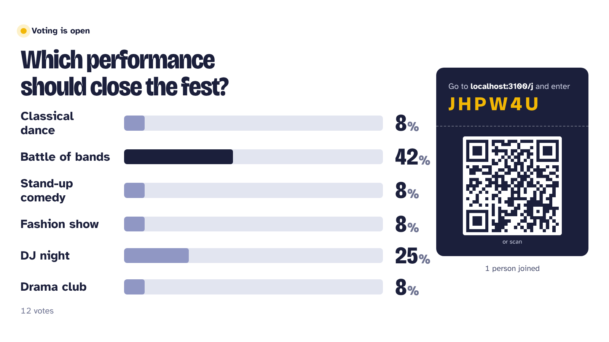
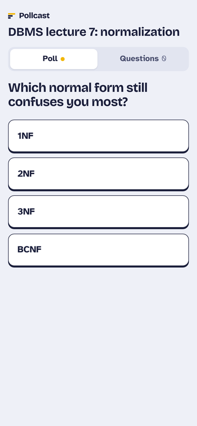
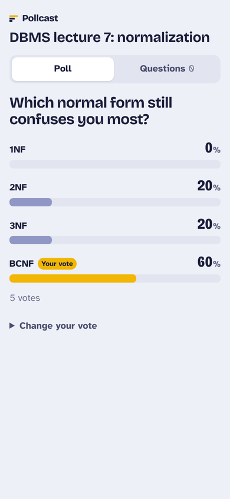
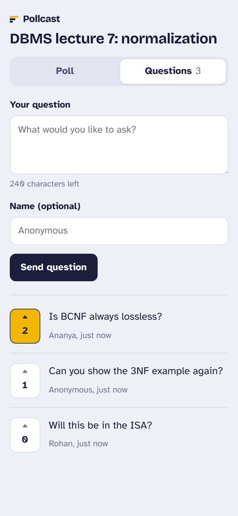
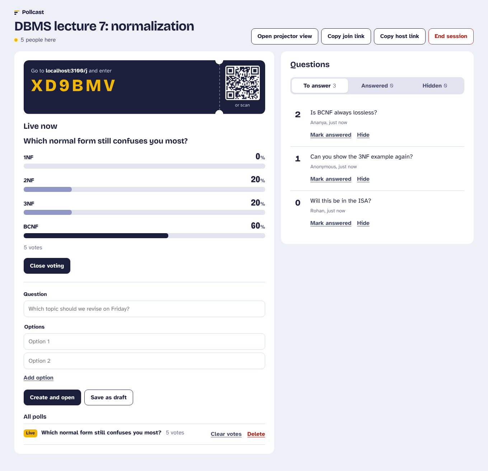

# Pollcast

[](https://github.com/dhananjaypesu/pollcast/actions/workflows/ci.yml)

Live polls and audience Q&A for lectures, club meetings and college fests. A presenter
starts a session, the room joins from their phones with a six-character code or a QR
scan, and votes and questions show up on every screen in real time. Nobody needs an app
or an account.



| Phone: vote | Phone: live results | Phone: questions |
|---|---|---|
|  |  |  |



## Features

**For the presenter**
- Create a session in one step; get a join code, a QR code and a projector view
- Write polls with 2–6 options, save them as drafts, and open them one at a time
- Watch results update live, close voting, reopen it, or clear the votes
- Moderate questions: sort by upvotes, mark them answered, or hide them
- Continue on another device with a private host link

**For the audience**
- Join from any phone browser with a code or QR scan
- Vote and change your vote while the poll is open; see results after voting
- Ask questions, optionally with your name, and upvote other people's questions
- Your votes survive a reload or a phone going to sleep

**Projector view**
- Full-screen results sized for the back row, with the join code and QR always visible
- Shows the top unanswered questions when no poll is on screen
- Fits six options on 720p, 900p and 1080p screens without scrolling

## How it works

```
 Phones (audience)            Laptop (presenter)          Projector
        │                            │                        │
        └──────── Socket.IO (WebSocket) ──────────────────────┘
                              │
                     Express + Socket.IO server
                              │
                            SQLite
```

- **Real-time sync:** each change (a vote, a question, a moderation action) goes to the
  server as a Socket.IO event with an acknowledgement. The server validates it, writes
  it to SQLite, and broadcasts a fresh session snapshot to everyone in the session.
- **Burst handling:** when a room of 200 people votes in the same second, updates are
  coalesced into one broadcast per 100 ms instead of 200 separate ones.
- **Two audiences, one snapshot:** the host room receives drafts and hidden questions;
  the public room never does.
- **Identity without accounts:** each phone keeps a random participant ID in local
  storage. One vote per participant per poll is enforced by the database's primary key,
  and changing your vote updates the row instead of adding one.
- **Host security:** creating a session returns a random host token. Only its SHA-256
  hash is stored, and it is checked with a constant-time comparison.
- **Abuse limits:** rate limits on session creation (per IP), question asking and
  voting (per participant); validation and length limits on every input with Zod; a 16 KB
  cap on socket messages.

## Tech stack

| Layer    | Choice |
|----------|--------|
| Frontend | React 19, TypeScript, React Router, Vite, hand-written CSS |
| Backend  | Node.js, Express 5, Socket.IO, Zod |
| Database | SQLite via better-sqlite3 (WAL mode, foreign keys) |
| Testing  | Vitest (unit and Socket.IO integration), Playwright (end-to-end) |
| Delivery | Docker, GitHub Actions |

Types for every socket event are shared between the server and client in
[`shared/types.ts`](shared/types.ts), so a renamed field breaks the build instead of the
live session.

## Getting started

Requires Node.js 20 or newer.

```bash
git clone https://github.com/dhananjaypesu/pollcast.git
cd pollcast
npm install
npm run dev
```

Open http://localhost:5173 to start a session. To try it with your phone on the same
Wi-Fi, run `npm run dev:client -- --host` and open the network URL it prints.

Production build:

```bash
npm run build
npm start            # serves the app and API on http://localhost:3000
```

With Docker:

```bash
docker build -t pollcast .
docker run -p 3000:3000 -v pollcast-data:/data pollcast
```

| Variable        | Default              | Purpose                    |
|-----------------|----------------------|----------------------------|
| `PORT`          | `3000`               | HTTP port                  |
| `DATABASE_PATH` | `data/pollcast.db`   | SQLite file (`:memory:` for a throwaway database) |

## Tests

```bash
npm test             # 27 unit and integration tests
npm run test:e2e     # 3 Playwright tests in a real browser
npm run typecheck
```

The integration tests start a real server and connect real Socket.IO clients. They
cover a full poll, vote changes, rejoining, Q&A moderation, host-token checks and rate
limits. The end-to-end test runs a whole lecture: a presenter, two phones and a
projector, from creating the session to marking a question answered.

## Project structure

```
pollcast/
├── shared/types.ts        # event and data types used by both sides
├── server/src/
│   ├── app.ts             # Express app, HTTP routes, static hosting
│   ├── realtime.ts        # Socket.IO events, rooms, broadcast batching
│   ├── store.ts           # all SQL: sessions, polls, votes, questions
│   ├── validation.ts      # Zod schemas
│   ├── rateLimit.ts       # token-bucket limiter
│   └── db.ts              # schema
├── server/test/           # Vitest unit and integration tests
├── client/src/
│   ├── pages/             # Home, Host, Audience, Screen
│   ├── components/        # result bars, join ticket, poll composer
│   └── lib/useSession.ts  # socket connection, rejoin, typed actions
├── e2e/                   # Playwright tests
└── Dockerfile
```

## What I'd add next

- Word-cloud and rating-scale question types
- Export results as CSV after a session
- Redis adapter for Socket.IO so it can run on more than one server

## License

MIT
